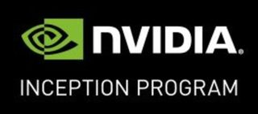

# OpenAMRobot: Open Embodied AI & Mobile Manipulation Ecosystem

OpenAMRobot is an open, modular, and affordable embodied AI robotics ecosystem initiated, operated, and controlled by **Botshare LTD** (Cyprus Company ID HE479056).

> [!IMPORTANT]
> ### Pre-order OpenAMRobot 2.0 at founder prices
> DIY kits and assembled robots: **30% off until 15 November 2026**, 25% off 16 to 30 November, 20% off 1 to 31 December. Full payment, price locked, first dispatch April 2027.
>
> **[See packages and pre-order on botshare.ai →](https://botshare.ai/openamrobot)**



The project began as an autonomous dual-arm mobile robot platform and is now evolving toward a full-cycle infrastructure for:

- mobile manipulation
- teleoperation
- imitation learning
- embodied AI research
- human-centered robot policy training
- and AI-driven robotics development

OpenAMRobot combines:

- autonomous mobile robotics
- dual-arm manipulation
- a lift for the arms, approved in principle for OpenAMRobot 2.0 (release gates still open): DOLD Hexalift V4 350 mm, shoulder 1000 to 1350 mm, lift base plate centre or +50 mm, arm profile 180 mm ahead of the column axis
- AI-based perception
- wearable embodied AI data collection
- ROS 2 software infrastructure
- embedded firmware
- simulation and navigation systems
- teleoperation and policy training pipelines
- and modular edge AI architectures

into a flexible, scalable, and research-oriented robotics ecosystem.


The platform is designed not as a fixed product, but as an open and extensible infrastructure that can be adapted for:

- industrial automation
- embodied AI research
- logistics and warehouse robotics
- grocery and retail order picking (one of our first demonstration use cases)
- educational platforms
- teleoperation systems
- human-robot collaboration
- and next-generation autonomous robotic applications.

OpenAMRobot focuses on building affordable and reproducible robotics infrastructure while reducing dependence on closed proprietary ecosystems and vendor lock-in.


Our mission is to make advanced mobile robotics accessible by providing high-quality, open-source, production-oriented designs that help SMEs, entrepreneurs, researchers, students, and robotics specialists build reliable and affordable autonomous robots without reinventing foundational technology.

---
## Commercial Availability

OpenAMRobot is available as:

- Open-source software
- DIY development kit
- Fully assembled mobile robot
- Dual-arm Embodied AI platform
- Custom engineering project
- OEM platform

# Commercial Options

OpenAMRobot 2.0 is open for pre-order at founder prices until 31 December 2026. Prices in EUR, excluding VAT, Berlin time. List prices apply from 1 January 2027.

| Package | List | 30% off, to 15 Nov | 25% off, 16 to 30 Nov | 20% off, 1 to 31 Dec |
|---|---:|---:|---:|---:|
| **DIY Mobile Platform kit**: complete OpenAMRobot 2.0 base as a parts kit (chassis parts, drivetrain, electronics, compute, sensors), assembled by you | €5,500 | **€3,850** | €4,125 | €4,400 |
| **Assembled Mobile Platform**: the same base, assembled and tested in Berlin | €7,000 | **€4,900** | €5,250 | €5,600 |
| **DIY Dual-Arm Manipulator kit**: base parts kit, lift and two OpenArm 2.0 arms, assembled by you | from €12,800 | **from €8,960** | from €9,600 | from €10,240 |
| **Assembled Dual-Arm Manipulator**: base, lift and two OpenArm 2.0 arms, assembled and tested in Berlin | from €14,800 | **from €10,360** | from €11,100 | from €11,840 |
| **Premium Embodied AI Training Kit**: assembled dual-arm robot with two OpenArm 2.0 arms, OpenArm KER leader set for teleoperation, and the AI pipelines | from €25,000 | **from €17,500** | from €18,750 | from €20,000 |

**[Pre-order on botshare.ai →](https://botshare.ai/openamrobot#prices)** · Full payment, price locked, first dispatch April 2027. Refund rules, delivery and VAT are in the [pre-order FAQ](https://botshare.ai/openamrobot#faq).

OpenAMRobot 2.0 is designed for the TZBOT WCM-500-24 wireless charger, which is not included in these packages; every package includes a Daly charger for manual charging. Batteries are not included; each robot is built for the specified LiFePO4 pack, sourced locally by the buyer. Delivery is at the buyer's cost.

### Premium Embodied AI Training Kit

A complete Physical AI development and deployment platform designed to enable **domain experts - not robotics engineers - to teach robots new tasks by demonstration**.

The kit combines the assembled dual-arm robot (two OpenArm 2.0 arms), the OpenArm KER leader set for teleoperation, and the software and AI pipelines required for:

- teleoperation and human task demonstration;
- demonstration recording and dataset collection;
- dataset management and preparation;
- imitation learning and VLA-based training workflows;
- simulation and evaluation;
- deployment of trained robot policies;
- human correction and intervention;
- iterative task improvement and validation.

The objective is to move from conventional robot programming toward a simpler workflow:

**Demonstrate → Learn → Evaluate → Correct → Deploy**

> **The robot is the hardware platform. The product is the ability for a domain expert to teach it a new task.**

> **Note:** Advanced AI capabilities are under active development and will be introduced progressively as the OpenAMRobot Physical AI stack matures. Exact hardware, software capabilities, integration scope, and pricing depend on the application.

> **Note:** Prices are indicative starting prices for standard configurations. Final pricing depends on hardware options, sensors, robotic arms, computing platform, manufacturing location, and customization requirements.

If you are interested in purchasing a platform or discussing your requirements, please contact us - info@botshare.ai.

## Engineering & Customization Services

Beyond the open-source platform, we help startups, SMEs, research laboratories, and enterprises develop custom robotic solutions based on OpenAMRobot.

Our services include:

- Robotics architecture and system design
- Hardware and electronics development
- PCB design and embedded firmware
- ROS 2 software development
- AI and computer vision integration
- Mechanical design and CAD
- Simulation and digital twins
- Autonomous navigation
- Mobile manipulation
- Product development
- Rapid prototyping
- Manufacturing support
- Corporate training and technical workshops

Whether you need a custom mobile robot, a proof of concept, or a complete production-ready solution, our engineering team can help accelerate your development.

Fixed-scope offers (Technical Review, Engineering Sprint, Discovery Workshop, Build Partner and Platform packages, monthly support): **[botshare.ai/services →](https://botshare.ai/services)**

---
## 🎥 Demo (release v0.0.1)

[](https://youtu.be/i6PCJFTgUF8)

▶️ **Click the image to watch the demo**

> [!NOTE]
>
> Download the complete product release (Hardware + Software + Firmware + UI + Documentation) here:
>
> **https://github.com/openAMRobot/openamrobot-release/releases/latest**

---

> [!IMPORTANT]
> ## OpenAMRobot Ecosystem Architecture
>
> OpenAMRobot is transitioning from a monolithic repository structure into a modular robotics ecosystem focused on:
>
> - maintainability
> - scalability
> - interoperability
> - contributor onboarding
> - long-term open-source collaboration
> - simulation-first robotics development
>
> 
>

## Ecosystem Repository Structure

```
openAMRobot/
│
├── .github/                  # org-wide config & community health files
│
├── openamrobot-manifest      # workspace manifest: which repos + which versions
├── openamrobot-interfaces    # shared ROS 2 msgs/services/actions + device.yaml schema
├── openamrobot-comm          # comm protocols, middleware, transport
├── openamrobot-ui            # operator UI, dashboards, Device Package panels
├── openamrobot-manipulation  # arm framework + arms (OpenArm 2.0 primary, LeRobot SO-101 fixture)
├── openamrobot-docs          # central docs, onboarding, compatibility
├── openamrobot-release       # frozen, versioned product snapshots
│
├── openamr-platform-sw       # AMR ROS 2: sim, nav2, docking, control, drivers, perception
├── openamr-platform-fw       # AMR firmware: motor/sensor bridges, safety I/O
├── openamr-platform-hw       # AMR mechanical, electrical, CAD, BOM
├── openamr-upperbody-sw      # arm + lift (approved in principle), MoveIt, bringup
├── openamr-upperbody-fw      # end-effector, safety I/O
├── openamr-upperbody-hw      # lift (approved in principle), plates, wiring, BOM

```

## Active Core Repositories

| Repository | Purpose |
|---|---|
| [`openamr-platform-sw`](https://github.com/openAMRobot/openamr-platform-sw) | ROS 2 software: simulation, navigation, docking, drivers, perception, bringup |
| [`openamr-platform-fw`](https://github.com/openAMRobot/openamr-platform-fw) | Embedded firmware, microcontroller systems, motor interfaces, hardware communication |
| [`openamr-platform-hw`](https://github.com/openAMRobot/openamr-platform-hw) | CAD, chassis, electrical, BOMs, manufacturing files, mechatronics |
| [`openamr-upperbody-sw`](https://github.com/openAMRobot/openamr-upperbody-sw) | Arm + lift (approved in principle), MoveIt on the combined model, bringup |
| [`openamr-upperbody-fw`](https://github.com/openAMRobot/openamr-upperbody-fw) | End-effector, upper-body safety I/O |
| [`openamr-upperbody-hw`](https://github.com/openAMRobot/openamr-upperbody-hw) | Lift (approved in principle), mounting plates, wiring, BOM |
| [`openamrobot-manipulation`](https://github.com/openAMRobot/openamrobot-manipulation) | Arm framework: manipulation server, Device Package format, arms (OpenArm 2.0 primary, LeRobot SO-101 fixture) |
| [`openamrobot-interfaces`](https://github.com/openAMRobot/openamrobot-interfaces) | Shared ROS 2 messages, services, actions, schemas, interface contracts |
| [`openamrobot-comm`](https://github.com/openAMRobot/openamrobot-comm) | APIs, middleware, telemetry, transport protocols, interoperability |
| [`openamrobot-ui`](https://github.com/openAMRobot/openamrobot-ui) | Operator interfaces, dashboards, visualization, user-facing apps |
| [`openamrobot-docs`](https://github.com/openAMRobot/openamrobot-docs) | Central documentation, onboarding, tutorials, safety, compatibility |

## Legacy Repositories

These repositories are preserved for historical context, migration support, forks, and compatibility reference. Active development targets the modular ecosystem repositories above. Repositories explicitly marked **archived** by GitHub are read-only.

- [`OpenAMR_UI_dev`](https://github.com/openAMRobot/OpenAMR_UI_dev) — archived; superseded by `openamrobot-ui`
- [`OpenAMR_UI_package`](https://github.com/openAMRobot/OpenAMR_UI_package) — archived; superseded by `openamrobot-ui`
- [`Botshare_docs`](https://github.com/openAMRobot/Botshare_docs) — legacy documentation source; superseded by `openamrobot-docs`
- [`openamr`](https://github.com/openAMRobot/openamr): legacy monorepo retained for historical reference
- [`EOD-robot`](https://github.com/openAMRobot/EOD-robot) — archived legacy EOD variant
>
> Active development should target the modular ecosystem repositories listed above.

---

## OEM & Partnership Opportunities

We welcome collaboration with:

- Robotics startups
- Universities
- Research institutes
- System integrators
- Industrial automation companies
- Manufacturing partners

Potential collaboration models include:

- OEM manufacturing
- White-label platforms
- Joint product development
- Technology transfer
- University education programs
- Industrial pilot projects

---

## Project Aim

While maintaining its original goals of accessibility and modularity, OpenAMRobot is evolving toward human-centric mobile robotics.

The platform emphasizes:

- shoulder-to-shoulder collaboration with human operators
- operator-in-the-loop control
- task handover
- assistance-oriented robotics
- modular automation systems

rather than isolated or rigid automation.

Robotic arm integration and height-adjustable linear actuators are treated as enabling components that allow the robot to adapt ergonomically to different tasks, workstations, and human collaborators.

The platform bridges:

- real-world deployment
- research
- education
- AI robotics
- industrial automation
- embodied AI experimentation

while addressing practical automation challenges in:

- manufacturing
- logistics
- CEP
- grocery delivery
- warehouse automation
- industrial assistance workflows

---

## Our system is built to

### Advance intelligent automation

Integrate computer vision and ML for:

- perception
- object recognition
- adaptive grasping
- autonomous assistance

in dynamic environments.

### Enable modular versatile manipulation

Combine:

- dual-arm robotic architecture
- interchangeable payload systems
- open hardware design
- modular ROS 2 software

for flexibility and customization.

### Remain open and cost-efficient

Target affordable and reproducible robotics technology suitable for:

- research
- education
- prototyping
- SMEs
- startups
- robotics labs

---

## Looking for a Custom Robot?

Need something beyond the standard platform?

We can customize OpenAMRobot for your application, including:

- custom chassis
- additional sensors
- robotic arms
- lifting mechanisms
- industrial I/O
- safety systems
- custom operator interfaces
- cloud integration
- fleet management
- AI and computer vision

Get in touch to discuss your project.

## Who Uses OpenAMRobot?

OpenAMRobot is designed for:

- Robotics startups
- Universities
- Research laboratories
- Corporate R&D teams
- Industrial automation companies
- System integrators
- SMEs exploring robotics
- AI and Embodied AI developers

# For Companies

OpenAMRobot is more than an open-source project.

We partner with companies to accelerate robotics development through:

- Engineering consulting
- Product architecture reviews
- Custom robot development
- Rapid prototyping
- Pilot projects
- Technology transfer
- Corporate training
- Manufacturing support
- Long-term R&D partnerships

Whether you're building your first robot or expanding an existing product, OpenAMRobot provides a proven foundation that can significantly reduce development time and cost.

---

### Quick Start for Contributors

1. Fork the relevant repository
2. Create a new branch
3. Make changes following project guidelines
4. Submit a Pull Request

Please read the repository-specific `CONTRIBUTING.md` before submitting contributions.

---

## Recognition of Contributors

OpenAMRobot is built by people, and contributors are always credited.

We recognize contributors through:

- GitHub commit history
- pull requests
- contributors lists
- documentation acknowledgements
- release notes
- maintainer roles for long-term contributors

---

## Maintainers

Maintainers are contributors who:

- actively review pull requests
- help guide technical decisions
- support the community
- improve architecture and governance

Maintainer roles are earned through contribution and trust.

## Maintainer

- **[@BotshareAI](https://github.com/BotshareAI)**: Alex Reznichenko, project lead
- **[@panthera-momagdii](https://github.com/panthera-momagdii)**: Mohamed Sayed, Tech lead

## Contributors

A sincere thank you to our contributors for their valuable time, effort, and contributions to the project:

- **[@Nahush11](https://github.com/Nahush11)**
- **[@SHuttooo](https://github.com/SHuttooo)**
- **[@rajindulkar22](https://github.com/rajindulkar22)**: former maintainer, UI and ROS 2 packaging

---

## Support OpenAMRobot

Support:

- open-source robotics
- ROS 2 development
- AI robotics education
- dual-arm mobile robot research
- affordable robotics infrastructure

## 💜 Support OpenAMRobot

Support open-source robotics, ROS 2 development, AI robotics education, and dual-arm mobile robot research.

### ⚡ Back the build — one-time, no strings

| Tier | What it says about you | Link |
|---|---|---|
| ⚡ **First Mover - €5** | You got here first, and you didn't overthink it. Your name goes on the backers wall - permanently - as one of the people who moved before it was obvious. Five euros, one good instinct. | <a href="https://buy.stripe.com/eVqcN5b99eeAaSd7WPgUM06" target="_blank" rel="noopener noreferrer">💳&nbsp;Back&nbsp;it&nbsp;→</a> |
| 🎯 **Sharpshooter - €25** | You spotted it early and called it. Name on the wall + a shareable "OpenAMRobot Backer" badge - proof you saw it coming while everyone else was still scrolling. | <a href="https://buy.stripe.com/4gMdR9ell1rO2lH90TgUM07" target="_blank" rel="noopener noreferrer">💳&nbsp;Back&nbsp;it&nbsp;→</a> |
| 🕶️ **Insider - €50** | You want in behind the curtain. Everything above + the backer-only build log and early files - every breakthrough, every faceplant, unfiltered. You see it before the internet does. | <a href="https://buy.stripe.com/eVq14nfpp4E0gcx2CvgUM08" target="_blank" rel="noopener noreferrer">💳&nbsp;Back&nbsp;it&nbsp;→</a> |
| 🔩 **Immortal - €100** | Your name goes on the actual robot. Physically. Forever. A machine will roll around carrying your name long after any of us remember why - and you'll have the photo to prove you were there. | <a href="https://buy.stripe.com/00w00jdhhb2o4tPfphgUM09" target="_blank" rel="noopener noreferrer">💳&nbsp;Back&nbsp;it&nbsp;→</a> |
| 🏆 **Founding Backer - €250** | Not merely a supporter — a founding backer. Everything above + a personal thank-you in a build video. When this becomes something, you were one of the people who decided it would. | <a href="https://buy.stripe.com/28EeVdcdddawaSdeldgUM0a" target="_blank" rel="noopener noreferrer">💳&nbsp;Back&nbsp;it&nbsp;→</a> |

### 🔁 Monthly subscriptions — build it with us, every month

| Tier | What you get | Link |
|---|---|---|
| 😇 **Benefactor - €5/mo** | This month, officially not wasted. €5 to help build an open robot for everyone - cheaper than the coffee you'll forget you bought. Your name goes on the wall. History will remember you - well, me for sure. 🤖 | <a href="https://buy.stripe.com/9B6cN5dhh9Yk7G1cd5gUM05" target="_blank" rel="noopener noreferrer">💳&nbsp;Subscribe&nbsp;→</a> |
| ❤️ **Community - €19/mo** | You're in. Community access, project & roadmap updates, basic documentation, and community Q&A. (Private consultation not included.) | <a href="https://buy.stripe.com/6oUcN55OPc6s3pL4KDgUM00" target="_blank" rel="noopener noreferrer">💳&nbsp;Subscribe&nbsp;→</a> |
| 🔧 **Builder - €79/mo** | For the ones who actually build. Everything in Community + builder docs, monthly group Q&A, selected tutorials, early design updates, and discounts on digital packs. (Private consultation not included.) | <a href="https://buy.stripe.com/14A28r0uvdaw9O9eldgUM01" target="_blank" rel="noopener noreferrer">💳&nbsp;Subscribe&nbsp;→</a> |
| 🚀 **Pro Support - €299/mo** | Expert support for advanced builders, early founders, and small labs. Includes 1 private consulting call per month and up to 3 hours/month of technical guidance. | <a href="https://buy.stripe.com/dRm4gz4KLdaw6BX4KDgUM02" target="_blank" rel="noopener noreferrer">💳&nbsp;Subscribe&nbsp;→</a> |
| 🏢 **Startup Support - €750/mo** | For robotics startups and teams heading toward a prototype. Includes 2 private consulting calls per month, roadmap support, GitHub/documentation review, supplier review, and up to 6 hours/month. | <a href="https://buy.stripe.com/7sY8wPfpp8Ugf8t90TgUM03" target="_blank" rel="noopener noreferrer">💳&nbsp;Subscribe&nbsp;→</a> |
| 🔬 **Lab Support - €1,500/mo** | For universities, corporate labs, and training centers. Includes 4 private sessions per month, lab implementation support, architecture reviews, training-roadmap support, and up to 10 hours/month. | <a href="https://buy.stripe.com/eVq14ndhh2vSaSda4XgUM04" target="_blank" rel="noopener noreferrer">💳&nbsp;Subscribe&nbsp;→</a> |

**❤️ GitHub Sponsors:** <a href="https://github.com/sponsors/openAMRobot" target="_blank" rel="noopener noreferrer"> 🐙 &nbsp;github.com/sponsors/openAMRobot&nbsp;→</a>

*Every contribution - €5 or €1,500 - literally builds this robot. No billion-dollar lab required. **You're not merely donating. You're helping build it.** 🤖*

---

## Planned releases

### OpenAMRobot 2.0 (in development)

- 20 Nov 2026: v2.0.0-rc.1 pre-release (design, software and manufacturing package)
- 23 Nov to 18 Dec 2026: physical integration and acceptance testing in Berlin
- 18 Dec 2026: v2.0.0 final release
- December 2026: hands-on hackathon with the robot at MotionLab.Berlin
- Current discussion: https://github.com/orgs/openAMRobot/discussions/27

What 2.0 brings:

- Dual-arm upper body: two OpenArm 2.0 arms (7 DoF each) on a lift, shoulder height 1000 to 1350 mm
- NVIDIA Jetson Orin NX as the single high-level computer; STM32H723 base controller over micro-ROS
- Hub-motor drive with fail-safe holding brakes, 25.6 V LiFePO4 battery, wireless charging
- Safety layer with two E-stops that cut motor power
- ROS 2, Nav2, MoveIt 2, ros2_control and the browser-based operator UI
- Embodied AI pipeline: demonstration recording, ACT imitation-learning baseline, evaluation

### OpenAMRobot 3.0 (development cycle starts January 2027)

- Suspension for the hub-motor drive
- Next steps of the teach-by-demonstration platform (VLA-based training)

### Ongoing

- Carrier PCB (compute + power + sensors)
  - Current discussion: https://github.com/orgs/openAMRobot/discussions/9

- ML-based computer vision
  - object recognition
  - grasp cues
  - perception pipelines

- Complete documentation
  - hardware
  - wiring diagrams
  - BOMs
  - assembly procedures
  - testing workflows

- Training and upskilling materials
  - robotics
  - ROS 2
  - AI
  - embedded systems
  - mechatronics

---

## Licensing, ownership, and contributions

OpenAMRobot is a project of **Botshare LTD**. Botshare LTD owns the transferable economic rights in original OpenAMRobot materials created by or validly assigned to it. Third-party materials remain subject to their respective owners, licences, and notices.

Public availability under MIT or another applicable open-source or open-hardware licence grants the permissions stated in that licence; it does not transfer ownership of underlying copyright, trademarks, patents, or other intellectual property.

Accepted external contributions require:

1. DCO sign-off for every commit; and
2. an accepted Individual or Corporate Contributor Agreement governing assignment of transferable economic rights to Botshare LTD.

Contributor attribution and legally non-waivable authorship or moral rights remain recognized.

See the canonical [IP Policy](https://github.com/openAMRobot/.github/blob/main/IP_POLICY.md), [Contribution Guide](https://github.com/openAMRobot/.github/blob/main/CONTRIBUTING.md), and [Contributor Agreement Process](https://github.com/openAMRobot/.github/blob/main/CLA.md).

**Botshare LTD** · HE479056 · Chrysanthou Mylona 1, Panayides Building, Floor 2, Office 1, 3030 Limassol, Cyprus · info@botshare.ai · https://botshare.ai
